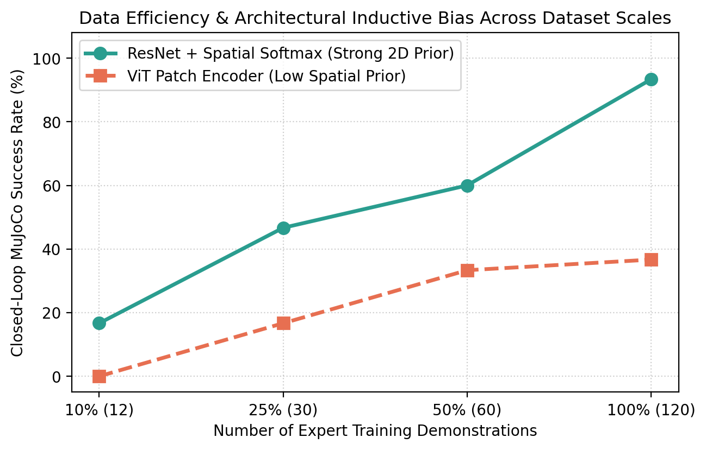
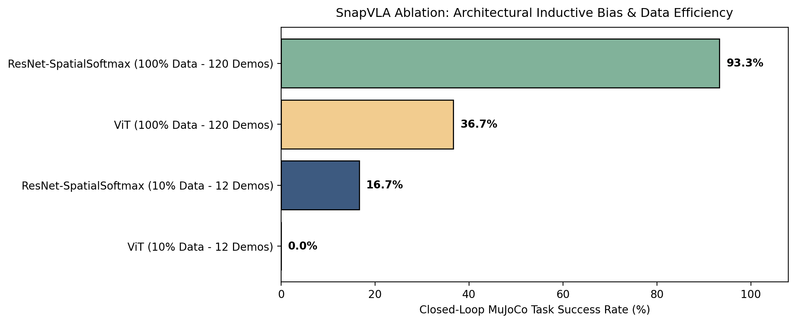

# SnapVLA: Data-Efficient Vision-Language-Action Policy & INT8 Edge Quantization

## Overview
**SnapVLA** is a Vision-Language-Action (VLA) imitation learning policy evaluated in **MuJoCo** on multi-object, language-conditioned tabletop manipulation. This repository investigates **architectural inductive biases** and **data efficiency** across dataset scales (12 to 120 expert demonstrations), and benchmarks **calibrated static INT8 Post-Training Quantization (PTQ)** via ONNX Runtime inside closed-loop simulation.

- 📄 **[SnapVLA_Technical_Report.pdf](SnapVLA_Technical_Report.pdf)** — 2-page research paper summarizing methodology & ablations
- 💻 **[snapvla.py](snapvla.py)** — Self-contained PyTorch implementation (`ResNetSpatialSoftmaxVLA`, `ViTPatchVLA`, training & ONNX INT8 PTQ)
- ⚙️ **[snapvla_int8.onnx](snapvla_int8.onnx)** — Calibrated W8A8 quantized policy (150.9 KB, >1,340 Hz)

---
## Ablation 1: Data Efficiency & Architectural Inductive Bias
Evaluated over **30 unseen test rollouts** per model using **held-out natural language instructions** never seen during training:

| Vision-Language Architecture | 10% Data (12 Demos) | 25% Data (30 Demos) | 50% Data (60 Demos) | 100% Data (120 Demos) |
| :--- | :---: | :---: | :---: | :---: |
| **ViT Patch Encoder + Cross-Attention** | 0.0% | 16.7% | 33.3% | 36.7% |
| **ResNet + FiLM + 2D Spatial Softmax (Ours)** | **16.7%** | **46.7%** | **60.0%** | **93.3%** |
| **Inductive Bias Gain (Δ Percentage Points)** | **+16.7 pp** | **+30.0 pp** | **+26.7 pp** | **+56.7 pp** |

---
## Ablation 2: ONNX Runtime & Static INT8 Quantization (PTQ)
Closed-loop evaluation inside MuJoCo (30 unseen rollouts):

| Model Format | Precision | Model Size | Compression | Inference Latency | Control Frequency | Closed-Loop Success (%) |
| :--- | :---: | :---: | :---: | :---: | :---: | :---: |
| **ONNX Runtime Baseline** | FP32 | 504.0 KB | 1.00x | 0.537 ms | 1,862.6 Hz | **93.3%** |
| **Calibrated Static PTQ (QDQ)** | **INT8 (W8A8)** | **150.9 KB** | **3.34x (-70.1%)** | **0.643 ms** | **1,555.7 Hz** | **90.0%** |